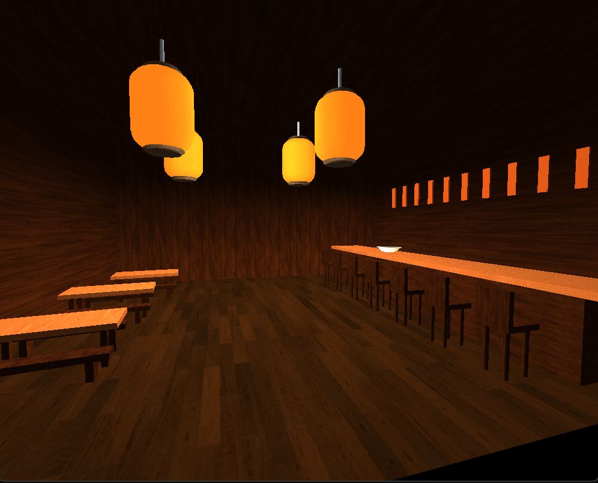
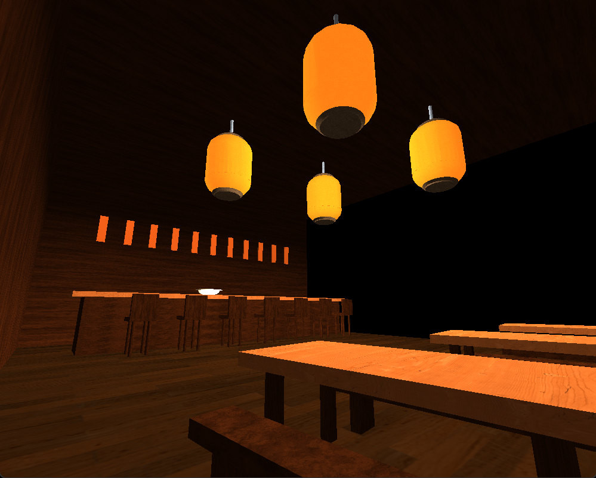
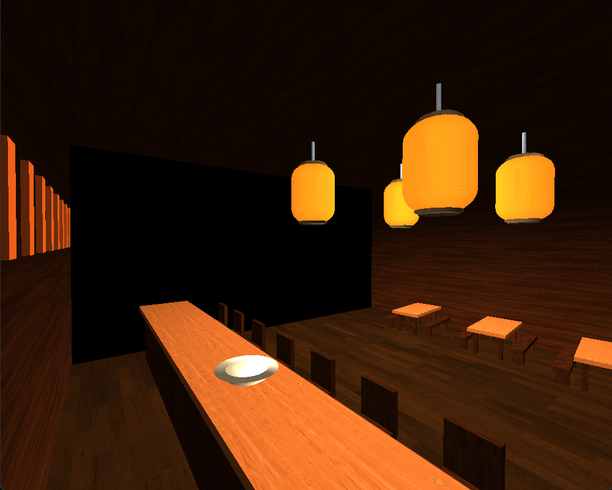

# Japanese Izakaya Interior · OpenGL Case Study

An interactive C++/OpenGL scene recreating the atmosphere and layout of a Japanese izakaya interior. The project used an instructor-provided rendering framework; my work focused on constructing the final environment, creating reusable scene objects, assigning textures and materials, tuning lighting, and refining camera and projection behavior.

**Available here:** screenshots of the completed scene and a technical case study. This repository does not include a standalone build or executable.

## Project Result

The final environment expanded an early milestone consisting primarily of a single lantern and floor plane into a complete interior containing hanging lanterns, a service counter, chairs and dining sets, walls and ceiling, wall plaques, benches, and a bowl prop.

### Default Scene View

### Alternate Scene Views

## My Contributions

- Constructed the scene from reusable geometric primitives and positioned the objects to approximate the chosen reference environment.
- Created reusable rendering functions including `RenderLantern()`, `RenderCounter()`, `RenderChair()`, `RenderBowl()`, `RenderPlaque()`, and `RenderDiningSet()`.
- Modeled hanging lanterns from combined primitive meshes and parameterized them for reuse at different scene positions.
- Selected and applied wood, metal, paper, and related surface textures/material characteristics.
- Tuned ambient, diffuse, and specular lighting to approximate the warm, dim appearance of illuminated paper lanterns within the limitations of the supplied Phong-style lighting system.
- Configured three warm lantern-area light sources plus a separate kitchen-area light within the framework's four-light limit.
- Refined the starting camera viewpoint and used interactive movement, vertical camera control, mouse look, scroll-controlled movement behavior, and perspective/orthographic projection switching.
- Iterated on scale, transforms, material values, object placement, and lighting after visually testing each change.

## Technical Approach

The scene was assembled in code from supplied primitive-mesh and rendering infrastructure rather than imported as a finished 3D model. Complex objects were composed from multiple primitives and then wrapped in reusable rendering functions so that instances could be placed or rotated without duplicating the entire construction sequence.

Lighting was the most iterative part of the project. A physically literal light source centered inside the lantern geometry produced undesirable hotspots, while disabling lighting or overusing ambient contribution flattened the material appearance. The final result used manually tuned lighting and material parameters to preserve shading while approximating a softly illuminated paper surface.

## Controls in the Original Application

| Input | Action |
|---|---|
| W / S | Move forward / backward |
| A / D | Move left / right |
| Q / E | Raise / lower the camera |
| Mouse movement | Look around |
| P / O | Select perspective / orthographic projection |
| Esc | Close the application |

The project reflection also describes using the scroll wheel to adjust movement speed. The archived view code forwards scroll input to a camera helper that is absent from the package, so that behavior has not been independently rerun.

## Technologies

C++ · OpenGL · GLSL · GLM · Geometric Transformations · Texture Mapping · Materials · Phong Lighting · Interactive Camera Controls

## Framework Attribution and Academic Integrity

This project was completed using an instructor-provided OpenGL rendering framework. The underlying rendering pipeline, shader/mesh infrastructure, and portions of the camera/rendering framework were not authored by me. My contribution was the scene-specific implementation and modification described above.

To avoid redistributing course-provided framework code or reusable academic assignment material, source files are intentionally omitted from this portfolio repository. The archived project references supporting framework files, shaders, libraries and textures that are not included in that archive. These screenshots document the original result; the application has not been rebuilt or rerun for this portfolio edition.

## Credits and Assistance

- **Rendering framework** — supplied for SNHU CS-330. The archived scene/view framework files credit SNHU instructor Brian Battersby; the scene-specific contributions are described above.
- **Textures** — the project reflection credits [ambientCG](https://ambientcg.com/) for several wood and metal textures. Individual asset identifiers were not retained in the archive, and texture files are not distributed here.
- **Visual reference** — K. Rune, “Exploring the Art of Japanese Izakaya Style Bar Design for an Authentic Dining Experience,” Sip The Style, May 27, 2025. The reference guided the layout and atmosphere; the images above show my rendered scene.
- **AI assistance** — ChatGPT supported brainstorming, code debugging and troubleshooting, generation and adjustment of the paper texture, comparison of lighting/material approaches, and proofreading of the original reflection. I reviewed, tested and revised suggestions during the project. AI assistance was also used to prepare this portfolio presentation.
